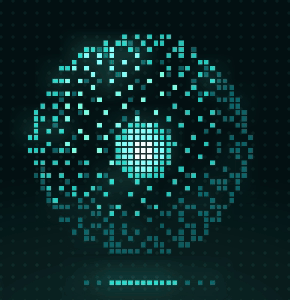
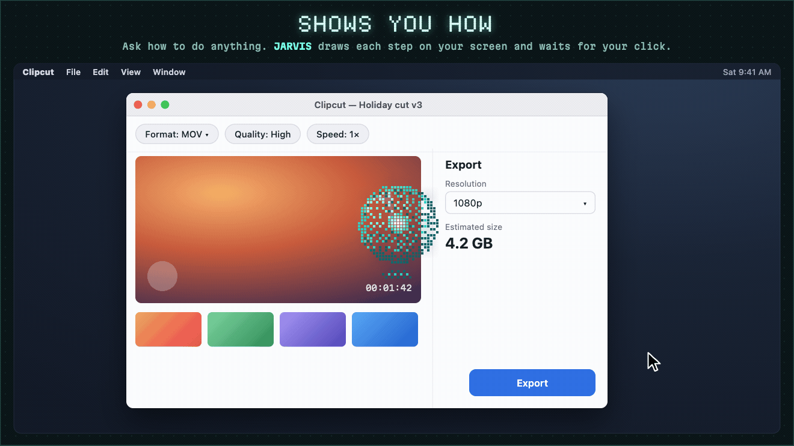
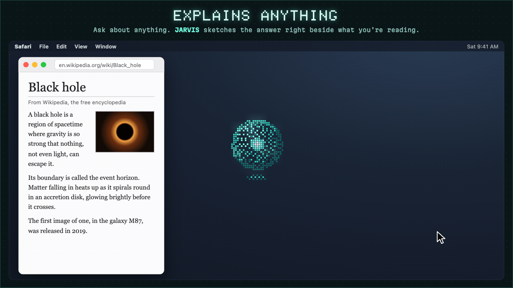

<div align="center">



<h1>Yomna</h1>

<p><strong>Talk to your computer like Yomna.</strong></p>

<p>It sees your screen, draws rich overlay cards, inspects windows, and delegates work to your local CLI agent harness — all grounded in your second brain.</p>

<p>


</p>

<p>⭐ Star it · <a href="YOUR_YOUTUBE_URL">YouTube</a> · <a href="YOUR_SKOOL_URL">Join the Skool community →</a></p>

<p><a href="#install">Install</a> · <a href="#how-it-works">How it works</a> · <a href="#harnesses">Harnesses</a> · <a href="#voice-modes">Voice modes</a> · <a href="#second-brain">Second brain</a> · <a href="#safety">Safety</a></p>

</div>

## Install

Linux (Omarchy / Hyprland & X11) and macOS:

```bash
curl -fsSL https://raw.githubusercontent.com/aammo1/yomna/main/get.sh | bash
```

Windows (PowerShell):

```powershell
curl.exe -fsSL https://raw.githubusercontent.com/aammo1/yomna/main/get.ps1 | powershell -NoProfile -ExecutionPolicy Bypass -Command -
```

Both installers verify release `SHA256SUMS` before installing.

Build from source instead:

```bash
git clone https://github.com/aammo1/yomna.git
cd yomna/showcase/tauri
(cd sidecar && npm ci && npm test)
./build.sh
```

- Needs Rust, Node.js 22+, [Tauri prerequisites](https://v2.tauri.app/start/prerequisites/)

## How it works

```md
# how-it-works.md

1. Hold Ctrl + Alt (or ⌃ + ⌥ on macOS, or toggle on Wayland) and talk
2. Yomna reads your notes and active screen context
3. Your CLI harness runs with yomna-desktop MCP tools
4. Yomna answers out loud and draws cards or points on screen
```

<p align="center"> </p>

## Harnesses

Yomna brings no direct LLM chat API keys or paid chat loops. Instead, it connects to the CLI agent harness you already use on your machine and attaches a local `yomna-desktop` MCP server (`take_screenshot`, area crop, `draw` cards, window inspection/control, reminders, focus, and jobs):

- **Antigravity (`agy`)** — default runtime harness
- **OpenCode (`opencode`)** — multi-provider open-source CLI harness
- **Pi (`pi`)** — lightweight coding/agent CLI harness
- **Claude Code (`claude`)** — optional user-selectable runtime harness
- **Custom ACP / CLI** — connect any compatible local ACP or CLI agent

No LLM API keys are required for **Classic Mode**: Yomna uses your local CLI harness authentication and runs voice locally.

## Voice modes

- **Classic Harness Mode (100% keyless & local):** Parakeet ONNX speech-to-text (or Apple on-device STT on macOS) → local CLI harness → Kokoro/Piper local TTS (with optional Edge TTS or VoiceStudio).
- **Gemini Live Mode (optional):** Real-time 16 kHz PCM voice conversation across Linux, Windows, and macOS using a free [Google AI Studio](https://aistudio.google.com/apikey) key, with `delegate_to_harness` to hand heavy tasks to your active CLI harness mid-call.

## Second brain

Your notes folder is the memory.

```
your-notes/
├── AGENTS.md
├── _context/
│   └── index.md
├── _raw/
├── _research/
├── projects/
│   └── index.md
└── .agents/
```

```md
# AGENTS.md

- Read _context first
- Cite _raw, never edit it
- Put outputs in _research
```

- Every chat starts with your `AGENTS.md`

## Shortcuts

```md
# shortcuts.md

talk       ⌃ + ⌥        Ctrl + Alt (or toggle via yomna --talk on Wayland)
highlight  ⌃ + ⌘        (Mac: hold and circle)
type       ⌥ + ⌘        Ctrl + Shift
show       ⌃ + ⌥ + S    Ctrl + Shift + S
```

## Safety

Risky things start off. Defaults:

```jsonc
// Change them in the panel. Fixed rules can't be turned off.
{
  "allowActions": false, // file edits, commands, app control
  "skipAllow":    false, // risky UI clicks ask Allow / Don't allow first
  "rawReadOnly":  true,  // fixed: _raw is never written
  "telemetry":    false  // fixed: nothing goes to the developer
}
```

- Data stays local or goes only to the CLI harness / optional live voice service you pick ([PRIVACY.md](PRIVACY.md))

## Settings

- Starters to copy into `~/Yomna/Data/settings.json` (keys stay in the OS keychain/keyring): [Classic](docs/settings.classic.example.json), [Live](docs/settings.live.example.json)

---

## Credits

- Derived from [Roamies](https://github.com/KenKaiii/Roamies) by Ken Kai (AGPL-3.0)
- License: [AGPL-3.0](LICENSE). Share source if you ship changes
- Other licenses: [THIRD_PARTY_NOTICES.md](THIRD_PARTY_NOTICES.md)

<sub>Art derived from Roamies by Ken Kai. Not affiliated with Marvel, Disney or Valve. [Issues & takedown requests](https://github.com/aammo1/yomna/issues)</sub>

<p align="center"><sub>Created with Antigravity.</sub></p>
