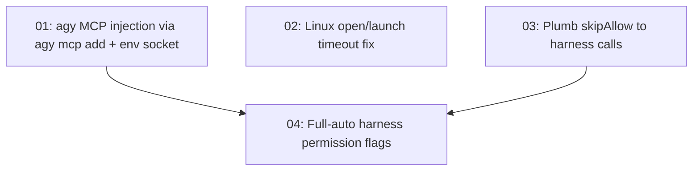

# Harness Full Actions

## Overview

Yomna only talks and doesn't do anything, even with "Allow File Edits & Commands" and "Skip Allow prompts" both on. Three code bugs cause this:

1. The `agy` harness (the default) crashes every turn because Yomna passes MCP servers through `--settings`, which `agy` rejects.
2. The harness permission modes only auto-approve file edits. Shell commands and tool calls still need approval, which can't happen in headless `-p` mode, so they stall or get denied.
3. On Linux, the `open` tool reports a 30 s timeout even when the app or page opened.

This spec fixes all three so Yomna can carry out tasks when the user has turned actions on.

## Quick Links

- [Requirements](./requirements.md): full requirements and acceptance criteria
- [Action Required](./action-required.md): manual steps that need a human

## Dependency Graph

## Waves

| Wave | Tasks | Description |
|------|-------|-------------|
| 1 | task-01, task-02, task-03 | Make agy runnable with MCP tools, fix Linux `open`, pass `skipAllow` down to harness calls |
| 2 | task-04 | Map `allowActions` and `skipAllow` to full-auto flags in agy and claude, and update the flag tests |

## Task Status

### Wave 1
- [x] [task-01-agy-mcp-injection](./tasks/task-01-agy-mcp-injection.md): agy MCP injection via `agy mcp add` + `YOMNA_MCP_SOCKET`
- [x] [task-02-linux-open-launch](./tasks/task-02-linux-open-launch.md): Linux `open`/`launch` treats a running launcher as success
- [x] [task-03-skipallow-plumbing](./tasks/task-03-skipallow-plumbing.md): Plumb `skipAllow` into every harness `send()` call

### Wave 2
- [ ] [task-04-harness-full-auto-flags](./tasks/task-04-harness-full-auto-flags.md): Full-auto permission flags for agy and claude
