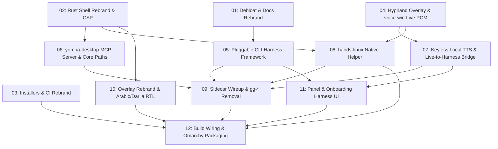

# Yomna v1 — Harness-Powered AI Desktop Companion

## Overview

Transform the cloned desktop companion base into **Yomna** (`aammo1/yomna`) — a brand-new, free open-source desktop AI companion for **Linux (Omarchy/Hyprland Wayland)**, **Windows**, and **macOS**, built with Antigravity for public YouTube and Skool community distribution. Yomna removes all direct chat LLM APIs (`@kenkaiiii/gg-*`, `~/.gg/auth.json`, paid Fish Audio TTS) and all `EricTechPro` / `Claude Code` creator branding, replacing the brain with a pluggable local CLI harness layer (**Antigravity `agy`** default, **OpenCode**, **Pi**, **Claude Code** as runtime option, and **Custom ACP/CLI**) connected to a local `yomna-desktop` MCP server, keyless local voice (Parakeet STT + Kokoro/Piper TTS), cross-platform **Gemini Live** (fixed for Linux & Windows), Arabic/Darija RTL canvas support, hardened Tauri CSP, and first-class Omarchy/Hyprland parity (`hands-linux`).

## Quick Links

- [Requirements](./requirements.md) — full requirements, constraints, and acceptance criteria
- [Action Required](./action-required.md) — manual human steps (Rust install, new GitHub repo, optional AI Studio key)

## Dependency Graph

## Waves

| Wave | Tasks | Description |
|------|-------|-------------|
| 1 | task-01, task-02, task-03, task-04 | De-bloat (`~51 MB`), rebrand docs/Rust/CI/installers to Yomna, harden CSP, fix Omarchy/Hyprland overlay & `voice-win` 16 kHz Live PCM + PipeWire |
| 2 | task-05, task-06, task-07, task-08 | Build pluggable CLI harness adapters (`agy`/`opencode`/`pi`/`claude`/ACP), `yomna-desktop` MCP server, keyless local TTS + Gemini Live bridge, and `hands-linux` |
| 3 | task-09, task-10, task-11 | Wire sidecar (`sidekick.mjs`) & remove `@kenkaiiii/gg-*`, rebrand overlay + fix Arabic/Darija RTL canvas bubbles, rebuild Panel & Onboarding for Harnesses + Dual Voice |
| 4 | task-12 | Wire `hands-linux` into build scripts & bundle config, sync end-to-end IPC, add Omarchy/Hyprland guide, and run final zero-leak verification |

## Task Status

### Wave 1
- [x] [task-01-debloat-and-docs-rebrand](./tasks/task-01-debloat-and-docs-rebrand.md) — Purge 51 MB bloat (`slides/`, `hero.*`, `beats/`) and rebrand root docs to Yomna
- [x] [task-02-rust-shell-rebrand-and-csp](./tasks/task-02-rust-shell-rebrand-and-csp.md) — Rebrand Tauri Rust/Swift shell to `com.aammo1.yomna`, add strict CSP, fix Linux tray crash & orphan cleanup
- [x] [task-03-installers-and-ci-rebrand](./tasks/task-03-installers-and-ci-rebrand.md) — Rebrand `get.sh`, `get.ps1`, `build.sh`, and GitHub Actions with SHA-256 verification
- [x] [task-04-linux-hyprland-overlay-and-voice-win](./tasks/task-04-linux-hyprland-overlay-and-voice-win.md) — Fix Hyprland overlay, 60s screenshot thread leak, PipeWire mic filter, and `voice-win` 16 kHz Live PCM streaming

### Wave 2
- [x] [task-05-harness-adapter-framework](./tasks/task-05-harness-adapter-framework.md) — Build pluggable background CLI harness framework (`agy`, `opencode`, `pi`, `claude`, custom ACP) with auto-detect & hang watchdog
- [x] [task-06-yomna-desktop-mcp-server](./tasks/task-06-yomna-desktop-mcp-server.md) — Build `yomna-desktop` local MCP server for screen/draw/app-control/reminders and rebrand core data/secrets/safety paths
- [x] [task-07-keyless-local-tts-and-live-bridge](./tasks/task-07-keyless-local-tts-and-live-bridge.md) — Build local Kokoro/Piper + Edge TTS drivers, remove Fish Audio, and wire Gemini Live `delegate_to_harness`
- [x] [task-08-hands-linux-helper](./tasks/task-08-hands-linux-helper.md) — Build `hands-linux` Rust helper (Hyprland IPC, `slurp`/`grim` area snap, `wtype`/`ydotool`, AT-SPI2)

### Wave 3
- [x] [task-09-sidecar-wireup-and-gg-removal](./tasks/task-09-sidecar-wireup-and-gg-removal.md) — Wire harnesses, `yomna-desktop` MCP, local TTS, and Linux/Windows Gemini Live into `sidekick.mjs` and remove `@kenkaiiii/gg-*`
- [x] [task-10-frontend-overlay-rebrand-and-rtl](./tasks/task-10-frontend-overlay-rebrand-and-rtl.md) — Rebrand desktop overlay to Yomna, prune dead Roamies code, and fix Arabic/Darija RTL canvas text rendering
- [x] [task-11-panel-and-onboarding-harness-ui](./tasks/task-11-panel-and-onboarding-harness-ui.md) — Rebuild Settings Panel & Onboarding Wizard for CLI harness auto-detect, keyless TTS, cross-platform Gemini Live, and clean changelog

### Wave 4
- [x] [task-12-build-wiring-and-omarchy-packaging](./tasks/task-12-build-wiring-and-omarchy-packaging.md) — Wire `hands-linux` into Tauri build, sync IPC contracts, add Omarchy/Hyprland setup guide, and verify zero branding leaks
